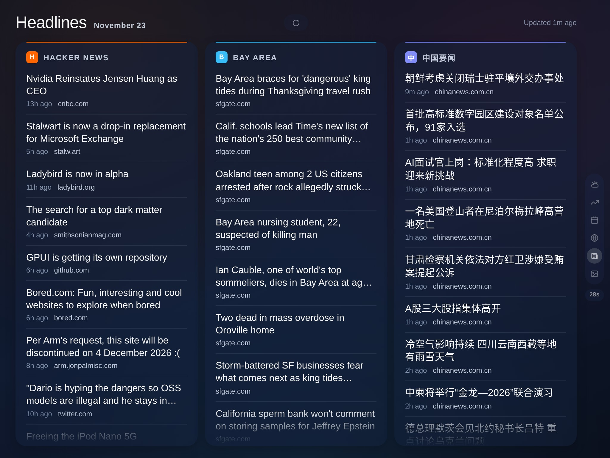
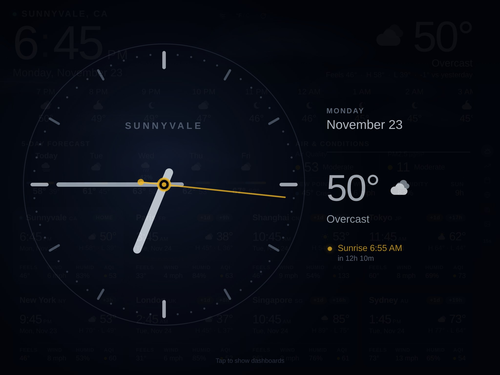

# Glance

An ambient personal wall dashboard PWA designed for an **iPad mini 2 (iOS 12.5.7, Landscape 1024×768)** — and modern iPads/desktops — with a stdlib-only **Go** API backend. Host it **locally on your LAN** or **serverless on Vercel**.

## Screenshots

Captured at the iPad mini 2's 1024×768 landscape resolution (Retina 2×).

| Weather | Stocks |
|---|---|
|  |  |
| **Calendar** (demo mode) | **World** |
|  |  |
| **Headlines** | **Photos** (demo mode) |
|  |  |
| **Night Ambient** | |
|  | |

---

## Quick Setup & Hosting

Glance works out of the box with live Weather, Stocks, and World data (no API keys required). Calendar, Photos, Headlines, and AI TL;DR summaries are optional and enabled via environment variables.

### 1. Choose How to Host

#### Option 1 — Host Locally (Mac / Linux / Raspberry Pi / Home LAN)

**Prerequisites:** [Node.js](https://nodejs.org/) 18+ and [Go](https://go.dev/dl/) 1.23+.

1. **Clone and install dependencies:**
   ```bash
   git clone https://github.com/hzqtc/glance.git
   cd glance
   npm install
   ```

2. **(Optional) Configure personal feeds & PIN:**
   Create a `.env.local` file in the project root (gitignored). See [Environment Variables](#environment-variables) below for all options. If `GLANCE_PASSCODE` is omitted locally, Glance opens directly without a PIN screen.
   ```bash
   cat <<'EOF' > .env.local
   # Optional: leave unset for open local access
   # GLANCE_PASSCODE=1234
   # GLANCE_SESSION_SECRET=$(openssl rand -hex 32)

   # Optional personal feeds
   # CALENDAR_ICS_URLS=https://...
   # PHOTOS_ALBUM_URLS=https://photos.app.goo.gl/...
   # NEWS_FEEDS=[{"name":"Hacker News","url":"https://news.ycombinator.com/rss"}]
   # GEMINI_API_KEY=...
   EOF
   ```

3. **Start the backend API and frontend in two terminals:**
   - **For daily wall-display use (recommended for iPad mini 2 / Safari 12 over LAN):**
     ```bash
     # Terminal 1 — Go API (http://127.0.0.1:8080/api/*)
     npm run dev:api

     # Terminal 2 — Safari 12-compatible production build served on your LAN (port 4173)
     npm run build && npm run preview
     ```
     Open `http://<your-computer-lan-ip>:4173` on your iPad (or `http://localhost:4173` on the same machine). Vite automatically proxies `/api/*` to the Go server on `127.0.0.1:8080`.

   - **For active development with live reload (Mac / modern browsers):**
     ```bash
     # Terminal 1 — Go API (reads config/dashboard.config.json live on every request)
     npm run dev:api

     # Terminal 2 — Vite dev server with HMR (port 5173)
     npm run dev
     ```
     Open `http://localhost:5173`.

---

#### Option 2 — Host on Vercel (Recommended for 24/7 Cloud Hosting)

Vercel builds the frontend and deploys every Go handler in `api/` as a serverless function automatically using [`vercel.json`](./vercel.json) and [`go.mod`](./go.mod).

**A. GitHub Auto-Deploy (easiest):**
1. Fork or push this repository to your GitHub account.
2. Go to [vercel.com/new](https://vercel.com/new) and import the repository.
3. Under **Environment Variables**, add the two required auth variables:
   - `GLANCE_PASSCODE` — your 4-digit PIN (e.g. `1234`)
   - `GLANCE_SESSION_SECRET` — a random 32+ character string (generate with `openssl rand -hex 32`)
   > Vercel fails closed if either variable is missing so your private feeds are never exposed accidentally.
4. *(Optional)* Add `CALENDAR_ICS_URLS`, `PHOTOS_ALBUM_URLS`, `NEWS_FEEDS`, and `GEMINI_API_KEY` (see [Environment Variables](#environment-variables)).
5. Click **Deploy**. Any future commits (such as edits to `config/dashboard.config.json`) auto-deploy and reload on your wall-mounted iPad automatically.

**B. Vercel CLI:**
```bash
npx vercel login
npx vercel link
# Add required env vars (repeat for any optional ones)
npx vercel env add GLANCE_PASSCODE production
npx vercel env add GLANCE_SESSION_SECRET production
# Deploy
npx vercel --prod
```

> **Vercel Go layout note:** Vercel turns every `.go` file in `api/` into an independent serverless function, so every file in `api/` must export an HTTP handler. Shared Go helpers live in packages outside `api/` (like `auth/` and `config/`).

---

### 2. Environment Variables

Set these in `.env.local` (for local hosting) or **Project Settings → Environment Variables** (for Vercel):

| Variable | Required | Description |
|---|---|---|
| `GLANCE_PASSCODE` | Vercel only | 4-digit PIN to unlock the dashboard. Optional locally (unset = open access). |
| `GLANCE_SESSION_SECRET` | Vercel only | Random 32+ char secret (`openssl rand -hex 32`) for HMAC-SHA256 signing of the 1-year `HttpOnly` session cookie. Rotating either the PIN or secret logs out all devices. |
| `CALENDAR_ICS_URLS` | Optional | Private `.ics` / `webcal://` calendar URL(s). Accepts a single URL, comma/newline-separated URLs, or a color-coded JSON array: `[{"name":"Personal","color":"#38bdf8","url":"https://..."}]`. Alias: `CALENDAR_ICS_URL`. |
| `PHOTOS_ALBUM_URLS` | Optional | One or more Google Photos link-shared album URLs (comma/newline-separated or JSON array). Alias: `PHOTOS_ALBUM_URL`. |
| `NEWS_FEEDS` | Optional | JSON array of up to 4 RSS/Atom feeds (one column each), e.g. `[{"name":"Hacker News","url":"https://news.ycombinator.com/rss"}]`. |
| `GEMINI_API_KEY` | Optional | Free key from [Google AI Studio](https://aistudio.google.com/apikey) to enable 2–3 sentence AI TL;DR summaries in the Headlines popover. |
| `GEMINI_MODEL` | Optional | Override the Gemini model used by `/api/summary` (default: `gemini-flash-lite-latest`). |

<details>
<summary>Example <code>NEWS_FEEDS</code> &amp; useful RSS URLs</summary>

```env
NEWS_FEEDS=[{"name":"Hacker News","url":"https://news.ycombinator.com/rss"},{"name":"Bay Area","url":"https://www.sfgate.com/bayarea/feed/Bay-Area-News-429.php"},{"name":"中国要闻","url":"https://www.chinanews.com.cn/rss/importnews.xml"}]
```

- **Local news for any city:** `https://news.google.com/rss/headlines/section/geo/<City>%2C%20<Region>?hl=en-US&gl=US&ceid=US:en`
- **Chinese-language feeds:** 中新网 要闻 (`chinanews.com.cn/rss/importnews.xml`) or 滚动 (`…/scroll-news.xml`), 纽约时报中文网 (`cn.nytimes.com/rss/`), DW 中文 (`rss.dw.com/rdf/rss-chi-all`), RFI 中文 (`rfi.fr/cn/rss`), 人民网 时政 (`people.com.cn/rss/politics.xml`).

</details>

---

### 3. Customize `config/dashboard.config.json`

Edit [`config/dashboard.config.json`](./config/dashboard.config.json) to set your Home city (first in `cities`), additional world cities, units (`"F"` or `"C"`), clock format (`"12h"` or `"24h"`), night dimming/ambient hours, carousel schedule, stock watchlist, and Photos frame holiday themes:

```json
{
  "units": "F",
  "timeFormat": "12h",
  "idleResetSeconds": 60,
  "nightMode": { "enabled": true, "startHour": 23, "endHour": 7, "dimOpacity": 0.55 },
  "ambient": { "enabled": true, "resumeAfterSeconds": 60 },
  "photos": {
    "slideIntervalSeconds": 15,
    "holidayThemes": {
      "lunar-new-year": { "enabled": true, "start": "lunar-12-23", "end": "lunar-01-07" },
      "halloween": { "enabled": true, "start": "10-17", "end": "10-31" },
      "christmas": { "enabled": true, "start": "thanksgiving+4d", "end": "12-26" }
    }
  },
  "cities": [
    { "id": "sunnyvale", "name": "Sunnyvale", "region": "CA", "lat": 37.3688, "lon": -122.0363, "timezone": "America/Los_Angeles" },
    { "id": "paris", "name": "Paris", "region": "France", "lat": 48.8566, "lon": 2.3522, "timezone": "Europe/Paris" },
    { "id": "shanghai", "name": "Shanghai", "region": "China", "lat": 31.2304, "lon": 121.4737, "timezone": "Asia/Shanghai" },
    { "id": "tokyo", "name": "Tokyo", "region": "Japan", "lat": 35.6762, "lon": 139.6503, "timezone": "Asia/Tokyo" }
  ],
  "stocks": {
    "defaultRange": "1d",
    "symbols": [
      { "symbol": "GOOG", "label": "GOOG", "name": "Alphabet", "format": "currency" },
      { "symbol": "NVDA", "label": "NVDA", "name": "NVIDIA", "format": "currency" },
      { "symbol": "^GSPC", "label": "S&P 500", "name": "S&P 500 Index", "format": "points" },
      { "symbol": "^TNX", "label": "10Y Bond", "name": "US 10Y Treasury Yield", "format": "yield" }
    ]
  }
}
```

Each of the 15 built-in US & Chinese holiday themes under `photos.holidayThemes` (`lunar-new-year`, `lantern`, `dragon-boat`, `qixi`, `mid-autumn`, `new-year`, `valentines`, `st-patricks`, `easter`, `mothers-day`, `fathers-day`, `independence`, `halloween`, `thanksgiving`, `christmas`) can be toggled with `"enabled": true/false` and given custom `start`/`end` dates using `"MM-DD"`, `"YYYY-MM-DD"`, `"lunar-MM-DD"`, or floating holiday anchors like `"easter-7d"`, `"mothers-day-3d"`, `"fathers-day-3d"`, or `"thanksgiving+4d"`.

---

### 4. Wall-Mounted iPad Setup

1. Open your Vercel `https://...` URL (or local `http://<lan-ip>:4173`) in **Safari** on the iPad.
2. Tap **Share → Add to Home Screen** and launch **Glance** from the Home Screen for full-screen PWA mode.
3. On an older **iPad mini 2**, tap the top-center **Motion** icon once to switch to **Static** sky mode (saved per device so the A7 stays cool 24/7).
4. Set **Settings → Display & Brightness → Auto-Lock → Never** (and optionally enable **Do Not Disturb** or **Guided Access**).

---

## Features

- **One-Time 4-Digit PIN Gate:** Server-side verification via `GLANCE_PASSCODE` + `GLANCE_SESSION_SECRET` issuing a 1-year HMAC-SHA256 `HttpOnly` cookie, protecting all `/api/*` endpoints.
- **Vertical Auto-Rotating Carousel (Weather ↕ Stocks ↕ Calendar ↕ World ↕ Headlines ↕ Photos):** Cycles via `carousel.schedule` (default interleaves 60s of Photos between each dashboard) or `carousel.intervalSeconds` (15s). Pauses for `carousel.manualPauseSeconds` (60s) on manual swipe, right-side rail tap, or `↑`/`↓`.
- **Weather Dashboard (Slide 1):** Solar-elevation atmospheric sky canvas + vector SVG Moon phase, adaptive Day/Twilight/Night themes, 24-hour scrollable ribbon, 5-day forecast with Low→High range bars, US AQI / UV / Sunrise-Sunset, and tappable multi-city cards.
- **Stocks Dashboard (Slide 2):** Selected symbol hero with interactive scrubbable SVG area chart across 9 timeframes (`1D`–`ALL`), `$`/`%`/Market Cap card metric switcher, 20-card 4×5 watchlist grid, and smart market-hours polling (2m open / 15m closed).
- **Calendar Dashboard (Slide 3):** Swipeable Monday–Sunday month grid with Chinese lunar dates (1900–2100), built-in US Holidays, month/year nav, next-trip countdown pill, scrollable day agenda with `"NOW"` badges, and private `.ics` sync.
- **World Dashboard (Slide 4):** Equirectangular day/night map centered on Home with tappable **Sun** (subsolar coords, declination, Home sunrise–sunset), **Moon** (phase, illumination, sublunar coords, lunar day, tide regime), **Aurora ovals** (NOAA SWPC Kp-scaled width & color depth), **ISS** live orbit & footprint, **USGS M4.5+ earthquakes**, **active tropical cyclones** (NHC + GDACS), and city-derived **FX currency cards** (or custom `world.fxPairs`).
- **Headlines Dashboard (Slide 5):** Up to 4 RSS/Atom feeds in equal columns; tap any item for a summary, QR code to open on your phone, and optional Gemini AI TL;DR.
- **Photos Frame (Slide 6):** Full-bleed aspect-ratio-aware smart collages from Google Photos shared albums with EXIF date/location overlay, seasonal US & Chinese holiday ornaments, and tap/swipe navigation.
- **Night Ambient Mode:** During `nightMode` hours (11 PM–7 AM default), shows a dimmed analog clock with ticking second hand, date, Home weather, and sunrise countdown with subtle anti-burn-in pixel drift; pauses background timers and canvas animation until tapped.
- **24/7 iPad mini 2 (iOS 12) Stability:** Preact + Vite classic ES5 Safari 12 bundle (~127 KB gzipped + ~21 KB polyfills, no `<script type="module">` traps), offline `localStorage`/Service Worker resilience, auto-reload on new deployments, and a silent daily 3:30 AM reload.

---

## Preview & Demo Modes

Append `?demo=<mode>` to the URL to preview states immediately:
- **Weather & sky:** `?demo=night`, `?demo=day`, `?demo=sunset`, `?demo=rain`, `?demo=snow`, `?demo=storm`, `?demo=fog`, `?demo=cloudy`, `?demo=wind`
- **Night ambient:** `?demo=ambient` (shows the night ambient clock at any hour)
- **Calendar:** `?demo=calendar` (serves 3 generated sample calendars — Work, Personal, Family — with recurring events and a trip countdown through the real `.ics` pipeline)
- **Photos:** `?demo=photos` (uses 15 bundled stock photos from [`public/demo/photos/`](./public/demo/photos/); see [CREDITS](./public/demo/photos/CREDITS.md))
- **Holiday ornaments:** `?holiday=<id>` (e.g. `?holiday=christmas`, `?holiday=lunar-new-year`) previews any theme immediately; `?holiday=off` hides ornaments.

---

## Architecture

- **Frontend (`src/`):** Preact + TypeScript + Safari 12-safe CSS + 2D `<canvas>` weather backdrop and vector SVG charts/maps.
- **Shared Config (`config/`):** Embeds `config/dashboard.config.json` via `//go:embed` for Vercel while supporting live-from-disk overrides in local dev.
- **Go API (`api/` & `auth/`):** Stdlib-only handlers for `/api/auth`, `/api/weather`, `/api/stocks`, `/api/calendar`, `/api/photos`, `/api/world`, `/api/news`, and `/api/summary`.
- **Local Dev Server (`cmd/devserver/main.go`):** Mounts all `/api/*` handlers on `127.0.0.1:8080`, loads `.env.local`/`.env`, and reads `config/dashboard.config.json` live from disk.

## Tests, Build & Screenshots

```bash
npm run test:api     # Go unit tests
npm run build        # TypeScript check + Vite Safari 12 production build
npm run screenshots  # Refresh docs/screenshots/*.jpg using local servers + headless Chrome
```
