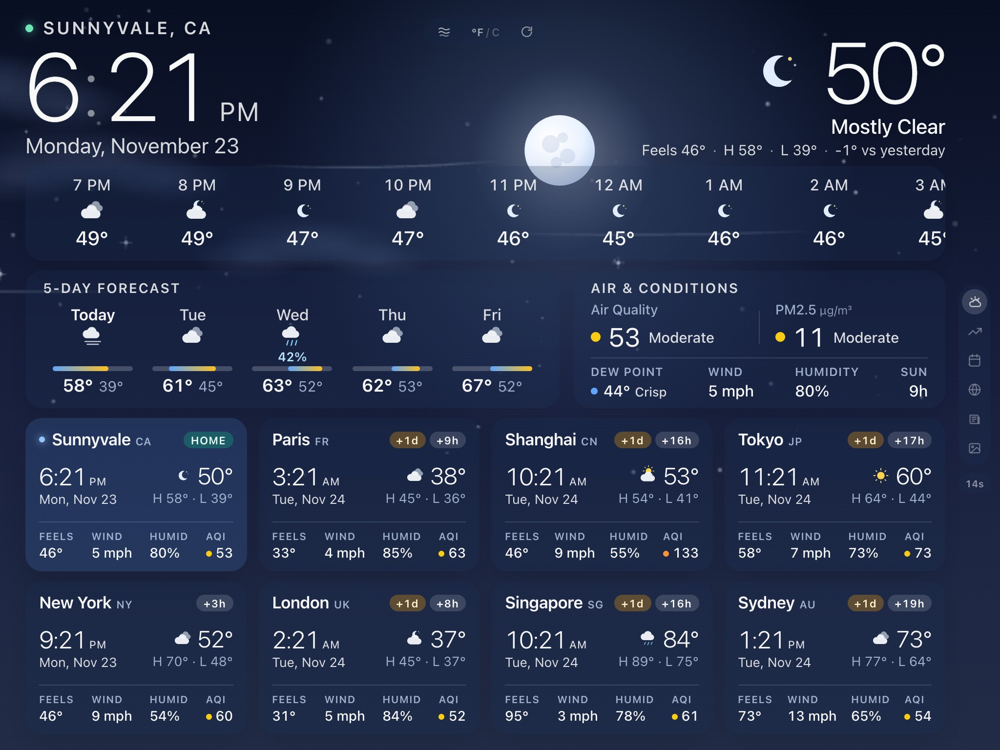
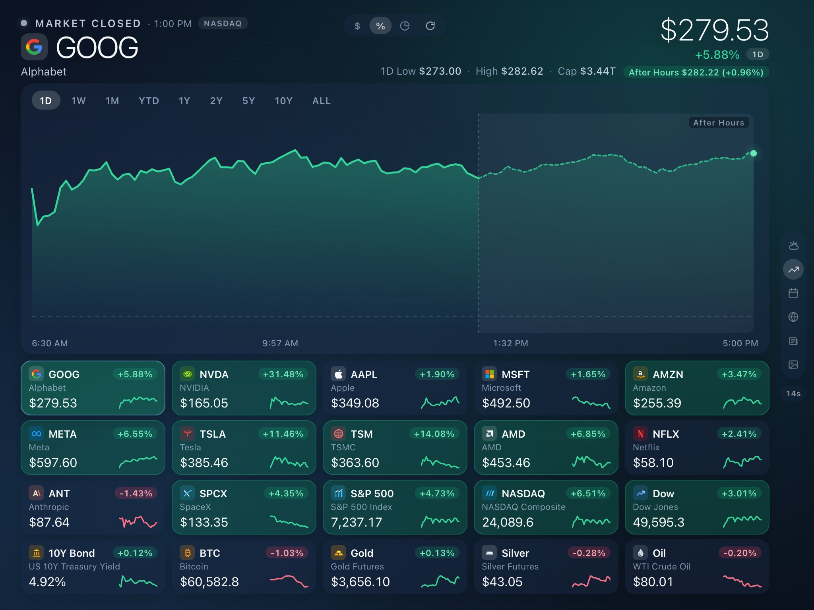
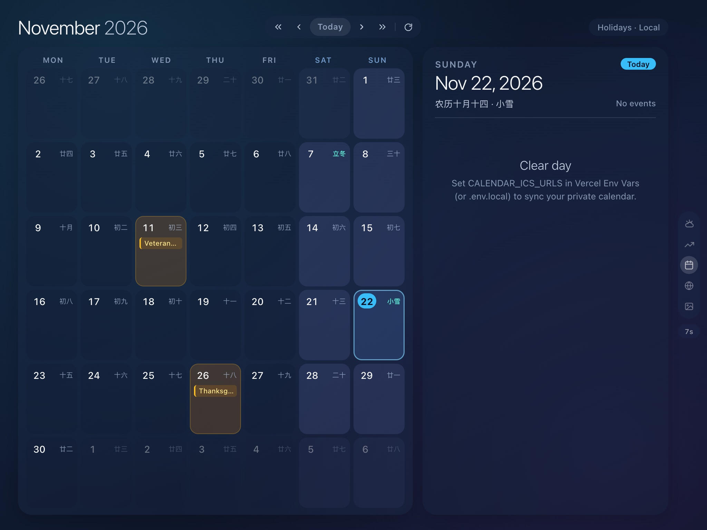
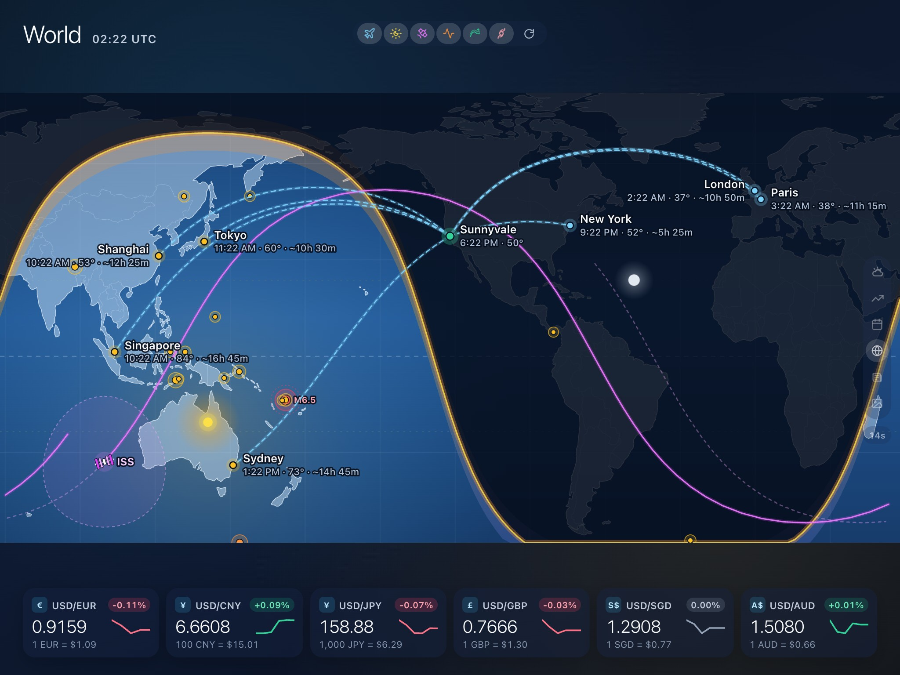

# Glance

An ambient personal wall dashboard PWA designed for an **iPad mini 2 (iOS 12.5.7, Landscape 1024×768)** — and modern iPads/desktops — hosted serverless on **Vercel** with a stdlib-only **Go** API backend.

## Screenshots

Captured at the iPad mini 2's 1024×768 landscape resolution (Retina 2×).

| Weather | Stocks |
|---|---|
|  |  |
| **Calendar** | **World** |
|  |  |
| **Photos** (demo mode) | |
|  | |

## Features

- **One-Time 4-Digit PIN Gate:**
  - Protected server-side via `GLANCE_PASSCODE` (stored in Vercel Environment Variables; never committed to Git or sent to the client). Issues a 1-year `HttpOnly` cookie on unlock, HMAC-SHA256 signed with a separate random `GLANCE_SESSION_SECRET` (32+ characters, e.g. `openssl rand -hex 32`) so the cookie can't be forged by guessing the PIN. Rotating either the PIN or the secret logs out every device. The gate blocks `/api/weather`, `/api/stocks`, `/api/calendar`, `/api/world`, and `/api/photos` until verified. Local dev allows open access when `GLANCE_PASSCODE` is unset, while Vercel fails closed if either variable is missing.
- **Vertical Auto-Rotating Carousel (Weather ↕ Stocks ↕ Calendar ↕ World ↕ Photos):**
  - Auto-cycles across dashboards every `carousel.intervalSeconds` (15s by default), or follows an explicit `carousel.schedule` of `{ "slide": "<weather|stocks|calendar|world|photos>", "seconds": N }` steps (the default schedule interleaves 60s of Photos between each 15s dashboard). Rotation pauses for `carousel.manualPauseSeconds` (60s by default) whenever you manually swipe up/down, tap the right-side icon rail, or press `↑`/`↓`.
- **Weather Dashboard (Slide 1):**
  - **Atmospheric Sky & Real Moon Phase:** Solar-elevation-driven sky canvas (dawn, day, sunset, twilight, night) paired with a crisp Retina vector SVG Moon showing tonight's actual astronomical phase, drifting clouds, twinkling stars, shooting stars, wind ribbons, rain, snow, fog, and storm flashes (celestial bodies hide automatically during overcast/precipitation).
  - **Adaptive Day / Twilight / Night Themes:** Light frosted-white borderless cards with crisp slate typography during daytime, warm twilight glass at sunrise/sunset, and lifted slate-blue frosted cards at night.
  - **Top Hero & Scrollable 24-Hour Forecast:** Large room-readable clock, temperature, compact weather metrics, subtle heads-up pills (imminent rain ≥60% or US AQI ≥101), and a horizontally scrollable 24-hour forecast ribbon.
  - **5-Day Forecast + Air & Daylight:** 5-day outlook with proportional Low→High temperature range bars alongside live US AQI, UV Index, Sunrise/Sunset, daylight duration, and countdown.
  - **Bottom City Row:** Displays all configured cities on a single landscape row (**Sunnyvale**, **Paris**, **Shanghai**, **Tokyo**, **New York**, **London**, **Singapore**, **Sydney** by default) with live clocks, relative hour offsets (`HOME`, `+9h`, `+16h`, `+17h`), `+1d` day badges, and Feels Like / Wind / Humidity / AQI stats. Tap any city card to switch the top two rows and living sky to that location.
- **Stocks Dashboard (Slide 2):**
  - **Selected Symbol Hero & Time-Series Chart:** Ticker with vector company/index logo, price, gain/loss delta, dynamic Low/High for the selected timeframe, subtle emerald/coral atmospheric backdrop glow, **9 timeframes (`1D`, `1W`, `1M`, `YTD`, `1Y`, `2Y`, `5Y`, `10Y`, `ALL`)**, and a crisp vector SVG area chart.
  - **4×5 Watchlist Grid:** 20 tappable cards (**S&P 500**, **NASDAQ**, **10Y Bond**, **NVDA**, **AAPL** / **MSFT**, **GOOGL**, **AMZN**, **META**, **TSLA** / **ANT**, **TSM**, **AMD**, **NFLX**, **BTC** / **Gold**, **Oil**, **Silver**, **SPCX**, **Dow**) with vector logos, live quotes, percent change pills, and mini intraday sparklines.
  - **Smart Market-Hours Polling:** Refreshes every 2 minutes during US market hours and every 15 minutes after-hours/weekends.
- **Calendar Dashboard (Slide 3):**
  - **Side-by-Side Month & Selected Day View:** Monday–Sunday month grid (swipe left/right for prev/next month) with Chinese lunar dates (1900–2100), built-in US Holidays, month/year navigation (`«`, `‹`, `Today`, `›`, `»`), next-trip countdown pill, and a scrollable agenda for the selected day with live `"NOW"` badges.
  - **Private `.ics` Sync (Zero Secrets in Git):** Reads `CALENDAR_ICS_URLS` from Vercel Environment Variables (or gitignored `.env.local` locally) — supports single URLs, comma/newline-separated URLs, `webcal://` iCloud URLs, or color-coded JSON arrays (`[{"name":"Personal","color":"#38bdf8","url":"https://..."}]`), served with `Cache-Control: private, no-store`.
- **World Dashboard (Slide 4):**
  - **Live World Map:** Seamless equirectangular map centered horizontally on the Home city, with the real-time day/night terminator, live ISS position and orbit track (propagated from TLEs via wheretheiss.at with a CelesTrak fallback), M4.5+ earthquakes from the past day (USGS), NOAA SWPC Kp-index aurora ovals, and active tropical storms (NHC + GDACS). Tap any marker for an inline popover with details.
  - **FX Currency Cards:** Live exchange rates derived automatically from your cities: the first (Home) city's currency is the base, and each other city adds its local currency (looked up from its `timezone`, deduplicated, in city order). The default cities give USD → EUR, CNY, JPY, GBP, SGD, AUD; a non-USD Home uses cross rates (e.g. `GBPJPY=X`). Cities whose timezone isn't in [`config/currency.go`](./config/currency.go) get no card. To pick pairs by hand instead, set `world.fxPairs` (e.g. `[{ "symbol": "KRW=X" }]`).
- **Photos Frame (Slide 5):**
  - **Pure Edge-to-Edge Smart Auto-Collage:** Reads one or more Google Photos link-shared album URLs from `PHOTOS_ALBUM_URL` / `PHOTOS_ALBUM_URLS` (stored in Vercel Environment Variables or gitignored `.env.local`). Automatically composes aspect-ratio-aware full-screen layouts (1 landscape hero, 2–3 side-by-side portraits, or 1 portrait + 2 stacked landscape bento grids), shuffles & crossfades every 15s, and supports tap or left/right swipe to jump between collages.
- **Minimalist Top-Center Controls:**
  - **Motion / Static icon toggle:** Switch between animated sky and 0-FPS static sky (saved per-device in `localStorage` so older iPad mini 2 hardware stays cool 24/7 while newer devices stay animated).
  - **°F / °C toggle:** Instant temperature & wind unit switching.
  - **Hard Refresh button:** Clears cached weather, unregisters Service Workers, purges Cache Storage, and performs a cache-busted full reload (ideal for Home Screen PWA mode).
- **Built for 24/7 iPad mini 2 (iOS 12) Stability:**
  - Preact + Vite with a classic ES5 Safari 12 production bundle (~22.5 KB gzipped) and zero `<script type="module">` traps.
  - Minute-aligned clock updates, auto night-dimming (`11 PM – 7 AM`), offline `localStorage`/Service Worker resilience, zero-touch auto-reload on new Vercel deployments, and a silent daily 3:30 AM reload.
  - Full iOS PWA assets (`152×152`, `167×167`, `180×180` Apple touch icons and `2048×1536` landscape launch splash screen).

## Configuration

Edit [`config/dashboard.config.json`](./config/dashboard.config.json) to customize units (`"F"` or `"C"`), clock format (`"12h"` or `"24h"`), night dimming hours, cities (which also determine the World FX cards), stock symbols, and future trip countdowns:

```json
{
  "units": "F",
  "timeFormat": "12h",
  "nightMode": { "enabled": true, "startHour": 23, "endHour": 7, "dimOpacity": 0.55 },
  "cities": [
    { "id": "sunnyvale", "name": "Sunnyvale", "region": "CA", "lat": 37.3688, "lon": -122.0363, "timezone": "America/Los_Angeles" },
    { "id": "paris", "name": "Paris", "region": "France", "lat": 48.8566, "lon": 2.3522, "timezone": "Europe/Paris" },
    { "id": "shanghai", "name": "Shanghai", "region": "China", "lat": 31.2304, "lon": 121.4737, "timezone": "Asia/Shanghai" },
    { "id": "tokyo", "name": "Tokyo", "region": "Japan", "lat": 35.6762, "lon": 139.6503, "timezone": "Asia/Tokyo" }
  ],
  "stocks": {
    "defaultRange": "1d",
    "symbols": [
      { "symbol": "^GSPC", "label": "S&P 500", "name": "S&P 500 Index", "format": "points" },
      { "symbol": "^IXIC", "label": "NASDAQ", "name": "NASDAQ Composite", "format": "points" },
      { "symbol": "^TNX", "label": "10Y Bond", "name": "US 10Y Treasury", "format": "yield" },
      { "symbol": "NVDA", "label": "NVDA", "name": "NVIDIA", "format": "currency" }
    ]
  }
}
```

## Architecture

- **Frontend (`src/`):** Preact + TypeScript + CSS custom properties (Safari 12-safe) + 2D `<canvas>` weather backdrop, vector SVG Moon, and vector SVG stock charts.
- **Shared Config (`config/`):** Embeds `config/dashboard.config.json` via `//go:embed` for Vercel serverless functions while supporting live-from-disk overrides in local dev.
- **Serverless Weather API (`api/weather.go`):** Stdlib-only Go `WeatherHandler` exposed at `/api/weather` on Vercel. Batches Open-Meteo Forecast (5-day + 24h hourly + 15-min nowcast) and Air Quality (US AQI + UV) concurrently with Edge caching (`s-maxage=600`).
- **Serverless Stocks API (`api/stocks.go`):** Stdlib-only Go `StocksHandler` exposed at `/api/stocks` on Vercel. Fetches Yahoo Finance chart series (`1D`–`ALL`) and watchlist quotes concurrently with smart market-hours Edge caching (`s-maxage=120` open / `s-maxage=900` closed).
- **Serverless Calendar API (`api/calendar.go`):** Fetches and parses the private `.ics` feeds from `CALENDAR_ICS_URLS` (including recurring events), served `private, no-store`.
- **Serverless Photos API (`api/photos.go`):** Resolves Google Photos shared-album links from `PHOTOS_ALBUM_URLS` into image URLs and dimensions for the collage layout, served `private, no-store`.
- **Serverless World API (`api/world.go`):** Concurrently fetches FX quotes (Yahoo Finance), ISS TLEs, USGS earthquakes, NOAA aurora Kp index, and tropical storms, each with its own in-memory cache (`?refresh=1` bypasses it).
- **Auth API (`api/auth.go` + `auth/`):** `GET /api/auth` reports lock status; `POST /api/auth` verifies the PIN (per-IP rate limited) and issues the signed session cookie.
- **Local Dev Server (`cmd/devserver/main.go`):** Mounts `/api/auth`, `/api/weather`, `/api/stocks`, `/api/calendar`, `/api/world`, and `/api/photos` on `127.0.0.1:8080`, loads secrets from `.env.local`/`.env`, and reads `config/dashboard.config.json` live from disk on every request.

## Local Development

Run the Go API and frontend in two terminals:

```bash
# Terminal 1 — Go API (http://127.0.0.1:8080/api/*)
npm run dev:api

# Terminal 2 — Modern dev server with HMR (Mac / modern iPads, port 5173)
npm run dev

# Or test the exact Safari 12 / iPad mini 2 production bundle on LAN (port 4173):
npm run build && npm run preview
```

### Preview & Demo Modes
Append `?demo=<mode>` to preview any condition immediately:
`?demo=night`, `?demo=day`, `?demo=sunset`, `?demo=rain`, `?demo=snow`, `?demo=storm`, `?demo=fog`, `?demo=cloudy`, `?demo=wind`.

`?demo=photos` fills the Photos slide with 15 bundled stock photos (from [`public/demo/photos/`](./public/demo/photos/), Unsplash License; see [CREDITS](./public/demo/photos/CREDITS.md)) instead of your Google Photos albums — handy for screenshots or trying the collage layouts without configuring `PHOTOS_ALBUM_URLS`.

## Deploy to Vercel

**Option A — GitHub Auto-Deploy (Recommended):**
Import this repository at [vercel.com/new](https://vercel.com/new) and click **Deploy** (Vercel detects [`vercel.json`](./vercel.json), [`go.mod`](./go.mod), and the Go handlers in `api/` automatically). Set `GLANCE_PASSCODE`, `GLANCE_SESSION_SECRET`, `CALENDAR_ICS_URLS`, and `PHOTOS_ALBUM_URLS` under **Project Settings → Environment Variables**. Pushing edits to `config/dashboard.config.json` auto-deploys and updates the wall-mounted iPad automatically.

**Option B — Vercel CLI:**
```bash
npx vercel login
npx vercel --prod
```

## Wall-Mounted iPad mini 2 Setup

1. Open your Vercel `https://...` URL in **Safari** on the iPad mini 2.
2. Tap **Share → Add to Home Screen** and launch **Glance** from the Home Screen.
3. Tap the top-center **Motion** icon once to switch to **Static** mode (persists across reloads so the A7 stays cool 24/7).
4. Set **Settings → Display & Brightness → Auto-Lock → Never** (and optionally enable **Do Not Disturb** or **Guided Access**).

## Tests & Build

```bash
npm run test:api   # Go unit tests
npm run build      # TypeScript check + Vite Safari 12 production build
```
